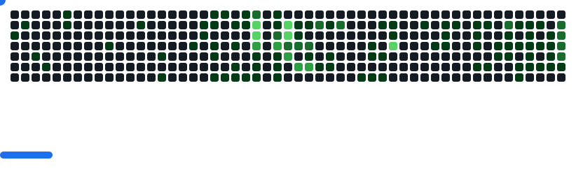

<!-- ═══════════════════════════ CABECERA ═══════════════════════════ -->

  

  

  
  

<!-- ═══════════════════════════ SKILLS ═══════════════════════════ -->
<h2 align="center">
  
  Skills
</h2>

  
   
  

<!-- ═══════════════════════════ TOOLS ═══════════════════════════ -->
<h2 align="center">
  
  Tools
</h2>

  

<!-- ═══════════════════════════ 3D CONTRIBUCIONES ═══════════════════════════ -->
<h2 align="center">
  
  My GitHub Stats
</h2>

  <picture>
    <source media="(prefers-color-scheme: dark)" srcset="./profile-3d-contrib/profile-night-rainbow.svg" />
    <source media="(prefers-color-scheme: light)" srcset="./profile-3d-contrib/profile-green-animate.svg" />
    
  </picture>

  

<!-- ═══════════════════════════ BREAKOUT ═══════════════════════════ -->

  <picture>
    <source media="(prefers-color-scheme: dark)" srcset="https://raw.githubusercontent.com/HumbleG0d/HumbleG0d/github-breakout/images/breakout-dark.svg" />
    <source media="(prefers-color-scheme: light)" srcset="https://raw.githubusercontent.com/HumbleG0d/HumbleG0d/github-breakout/images/breakout-light.svg" />
    
  </picture>

<!-- ═══════════════════════════ PIE ═══════════════════════════ -->

