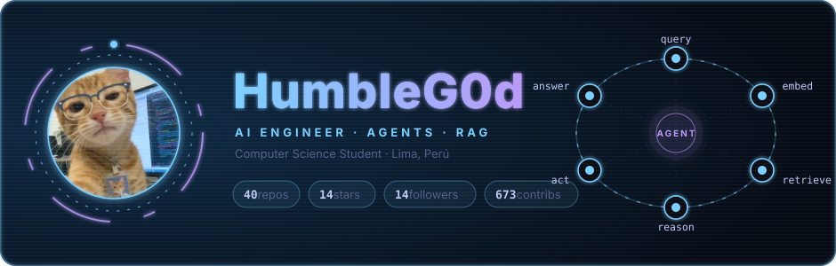

<!-- Las tarjetas se regeneran a diario con .github/workflows/profile.yml -->

  

  

  

  <picture>
    <source media="(prefers-color-scheme: dark)" srcset="https://raw.githubusercontent.com/HumbleG0d/HumbleG0d/github-breakout/images/breakout-dark.svg" />
    <source media="(prefers-color-scheme: light)" srcset="https://raw.githubusercontent.com/HumbleG0d/HumbleG0d/github-breakout/images/breakout-light.svg" />
    
  </picture>

